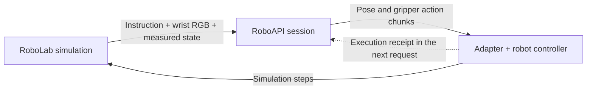

# roboapi-playground

**English** | [简体中文](README.zh-CN.md)

[](https://github.com/huashanjian/roboapi-playground/actions/workflows/roboapi.yml?query=branch%3Afeat%2Froboapi-eval)
[](LICENSE)

Run [RoboAPI](https://developers.pokebot.com/docs/roboapi/latest) policies on
[NVIDIA RoboLab](https://github.com/NVLabs/RoboLab) manipulation tasks with a
calibrated Franka/Robotiq robot and a wrist fisheye camera.

This fork adds the RoboAPI inference adapter, robot assembly builder and execution
logging. RoboLab's task definitions, episode loop and success checks are retained.

[Demos](#-demos) · [Try it out](#-try-it-out) · [Codebase tour](#-codebase-tour) · [Runs and evaluation](#-runs-and-evaluation) · [Documentation](#documentation)

## 🎬 Demos

### Putting electronic devices away

> Put the electronic devices in the grey bin


The robot moves the bin, then picks up the mouse and places it inside.

<table width="100%">
  <tr>
    <th width="50%">Stacking three cubes</th>
    <th width="50%">Turning a mug upright</th>
  </tr>
  <tr>
    <td width="50%"></td>
    <td width="50%"></td>
  </tr>
  <tr>
    <td>“Stack the rubiks cubes in a tower”<br />Preview at 3× replay speed.</td>
    <td>“Make sure all the white mugs are upright so that the opening is facing upwards.”</td>
  </tr>
</table>

Selected simulation rollouts. Recording durations reflect replay time and exclude
API waiting time. The external camera shown here is for viewing; the policy
receives the wrist camera image.

## 🛝 Try it out!

Start with **Python 3.11, Isaac Sim 5.1 and Isaac Lab 2.3.2.post1**.
Follow the [setup guide](docs/roboapi/setup.md#from-a-fresh-clone-to-your-first-episode)
to clone this branch, install the [calibrated rig assets](https://github.com/huashanjian/roboapi-playground/releases/tag/roboapi-rig-v1.0.0),
configure `.env.local` and build the robot.

From the repository root, first check the robot, gripper and camera without
calling the model:

```bash
policies/roboapi/run.sh --task BananaInBowlTask --num-runs 1 \
  --preflight-only --output-folder-name roboapi_preflight
```

Then, with your API key configured, run one episode:

```bash
policies/roboapi/run.sh --task BananaInBowlTask --num-runs 1 \
  --output-folder-name roboapi_single
```

The preflight report is at `output/roboapi_preflight/preflight.json`.
The episode writes to `output/roboapi_single/`. To try the featured task, replace
`BananaInBowlTask` with `ElectronicsInBinTask`. More tasks are listed in the
[RoboLab task catalog](robolab/tasks/README.md).

Keep `--task` and `--num-runs` explicit for a short trial. If both are omitted,
a normal evaluation targets all 120 tasks with 10 episodes per task; completed
episodes in the same output directory are skipped.

## 🗺️ Codebase tour

The adapter turns RoboLab observations into RoboAPI requests, maps the returned
actions into simulator coordinates and reports their execution:



- **Observations:** one wrist RGB image, the task instruction, measured tool pose
  and measured gripper opening. Object states and privileged task observations
  are not sent to the model.
- **Camera and coordinates:** native `OmniLensDistortionFthetaAPI` fisheye optics
  and a calibrated tool-to-camera transform. The intrinsic matrix calibrated at 1280 × 720 is scaled
  for the 640 × 360 policy image.
- **Control:** returned action chunks drive arm IK and the calibrated Robotiq
  response model. Feedback uses the measured gripper opening, rather than
  echoing the requested command.

| File | What to look for |
| --- | --- |
| [`run.py`](policies/roboapi/run.py) | Preflight, episode execution and run manifests |
| [`client.py`](policies/roboapi/client.py) | Observation/action frame mapping, action chunks and execution feedback |
| [`transport.py`](policies/roboapi/transport.py) | Model discovery, HTTP requests and session/response validation |
| [`build_asset.py`](policies/roboapi/build_asset.py) | Assembling the Franka, Robotiq and camera USD |
| [`registration.py`](policies/roboapi/registration.py) | Environment registration and the tool0 IK configuration |
| [`camera.py`](policies/roboapi/camera.py) | Fisheye optics, rendering settings and runtime checks |
| [`arm_action.py`](policies/roboapi/arm_action.py) | Arm IK, tool0 Jacobian correction and tool load compensation |
| [`gripper_response.py`](policies/roboapi/gripper_response.py) | Gripper delay, response limits and measurement sampling |

The [control notes](docs/roboapi/control.md) explain the coordinate conventions,
tool load compensation and gripper dynamics.

## 🧾 Runs and evaluation

Under `output/<run-name>/`, `manifest.json` records the code and package versions,
requested model and endpoint, task and seed lists, camera settings and rig
metadata. `episode_results.jsonl` stores episode outcomes.

Each episode also writes files under `<task>/run_<n>_api/`:

| Files | Contents |
| --- | --- |
| `observation_*.png` and `observation_*.json` | Wrist images, instructions, measured poses and gripper opening |
| `chunk_*.json` | Returned pose/gripper chunks, mapped simulator actions and request/session identifiers |
| `events.jsonl` and `summary.json` | Execution feedback, completed-step counts, timings, errors and the server-resolved model |

Preflight writes to its own output directory. Start with `preflight.json`,
`wrist_initial.png` and `runtime_camera.json` when checking an installation.

The runner supports **120 RoboLab task definitions**, with a uniform
**120-second simulated horizon** and at most **90 action chunks** per episode.
The demo GIFs show selected rollouts; aggregate success rates and model
comparisons are not included in this repository. The custom robot, camera and
time limits are described in [evaluation conditions](docs/roboapi/evaluation.md#evaluation-conditions).
Use the [complete evaluation tools](docs/roboapi/evaluation.md#complete-evaluation-tools)
to schedule all tasks and collect results.

## 🩹 Troubleshooting

| Symptom | Check first |
| --- | --- |
| Wrist view looks wrong | Compare preflight `wrist_initial.png` and `runtime_camera.json` with the episode's `observation_*.png`. Check camera paths, native lens support and renderer settings in [`camera.py`](policies/roboapi/camera.py). |
| Arm approaches the wrong location | Compare the native and policy poses in `observation_*.json` with `sim_actions` in `chunk_*.json`. Check the frame mapping in [`client.py`](policies/roboapi/client.py) and the preflight TCP tracking results. |
| Gripper releases or keeps correcting | Compare the returned opening commands in `chunk_*.json` with measured opening in `observation_*.json`. Inspect preflight `gripper_validation`, then the [response model](policies/roboapi/gripper_response.py) and [simulated joint control](policies/roboapi/gripper_action.py). |
| Simulator runs, but API calls fail | Check `ROBOAPI_TOKEN_FILE` and the endpoint/model settings in [`.env.example`](.env.example). Read the episode's `summary.json` and any `http_*_response.json` files; [`transport.py`](policies/roboapi/transport.py) handles session and response validation. |

<details>
<summary>Environment and asset questions</summary>

**Do I need a physical robot?** No. These tasks run in Isaac Sim.

**What comes with the rig bundle?** The tool assembly and camera/actuator
calibration. Obtain the Panda geometry, benchmark scenes and simulator
separately; see [required assets](docs/roboapi/setup.md#required-assets).

**Can I change the model?** Set `ROBOAPI_MODEL` and `ROBOAPI_BASE_URL` in
`.env.local`. The endpoint must implement the
[RoboAPI model API contract](https://developers.pokebot.com/docs/roboapi/latest/model-contract).

</details>

## Tests

Run the offline checks in a separate Python environment:

```bash
python -m pip install -r requirements-roboapi-tests.txt
scripts/test_roboapi.sh
```

These checks run without Isaac Sim or model calls. With PyTorch installed they
also exercise the gripper action buffers on CPU.

## Documentation

- [Installation, local configuration and calibrated assets](docs/roboapi/setup.md)
- [Coordinate frames, arm and gripper control](docs/roboapi/control.md)
- [RoboAPI protocol and evaluation](docs/roboapi/evaluation.md)
- [RoboLab task catalog](robolab/tasks/README.md)

## 🙏 Acknowledgements and license

Built on [NVIDIA RoboLab](https://github.com/NVLabs/RoboLab), using the
[RoboAPI](https://developers.pokebot.com/docs/roboapi/latest) policy interface.
The code is licensed under [Apache 2.0](LICENSE). Upstream history and NVIDIA
copyright notices are retained. Robot, tool and benchmark assets retain their
respective licenses; see [third party notices](THIRD_PARTY_NOTICES.md).

## Star History

<a href="https://www.star-history.com/?repos=huashanjian%2Froboapi-playground&amp;type=date&amp;legend=top-left">
  <picture>
    <source media="(prefers-color-scheme: dark)" srcset="https://api.star-history.com/chart?repos=huashanjian/roboapi-playground&amp;type=date&amp;theme=dark&amp;legend=top-left" />
    <source media="(prefers-color-scheme: light)" srcset="https://api.star-history.com/chart?repos=huashanjian/roboapi-playground&amp;type=date&amp;legend=top-left" />
    
  </picture>
</a>
