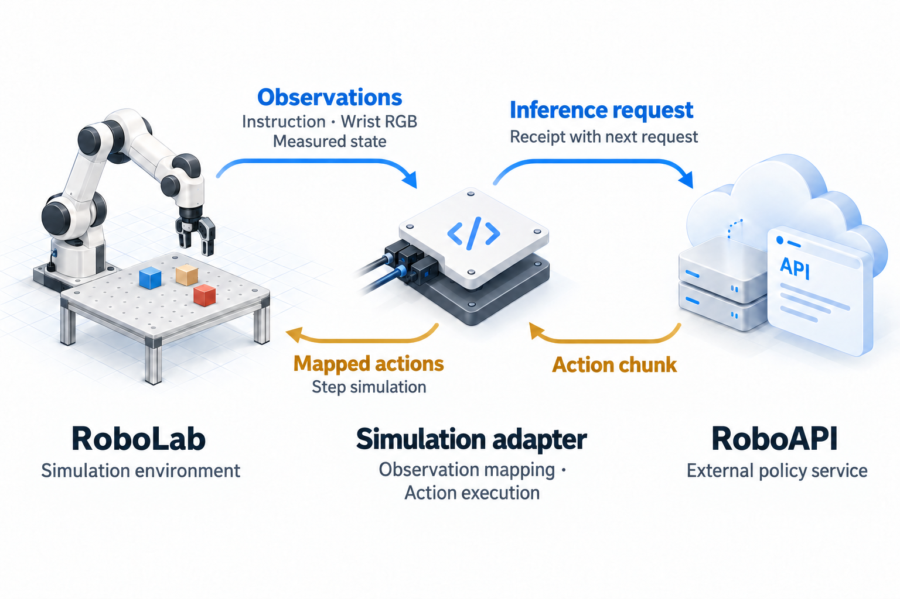

# roboapi-playground

**English** | [简体中文](README.zh-CN.md)

[](https://github.com/huashanjian/roboapi-playground/actions/workflows/roboapi.yml?query=branch%3Amain)
[](LICENSE)

Run [RoboAPI](https://developers.pokebot.com/docs/roboapi/latest) policies on the 120
[NVIDIA RoboLab](https://github.com/NVLabs/RoboLab) manipulation tasks in Isaac Sim,
with a calibrated Franka/Robotiq rig and a wrist fisheye camera.

The simulation adapter sends the wrist image and measured robot state to the RoboAPI service,
executes the returned action chunks and logs every request, so you can open any
episode and see what the policy saw and did.

This repository started as a fork of NVIDIA RoboLab and is now maintained independently.

[Demos](#demos) · [Try it out](#try-it-out) · [Codebase tour](#codebase-tour) · [Inspect a rollout](#inspecting-a-rollout) · [Extend](#extending-the-integration) · [Documentation](#documentation)

<a id="demos"></a>

## 🎬 Demos

### Putting electronic devices away

> Put the electronic devices in the grey bin


The robot moves the bin, then picks up the mouse and places it inside.

<table width="100%">
  <tr>
    <th width="50%">Stacking three cubes</th>
    <th width="50%">Turning a mug upright</th>
  </tr>
  <tr>
    <td width="50%"></td>
    <td width="50%"></td>
  </tr>
  <tr>
    <td>“Stack the rubiks cubes in a tower”<br />Preview at 3× replay speed.</td>
    <td>“Make sure all the white mugs are upright so that the opening is facing upwards.”</td>
  </tr>
</table>

Selected simulation rollouts. Simulated time pauses while the policy waits for
each response.

<a id="try-it-out"></a>

## 🛝 Try it out!

You need **Python 3.11, Isaac Sim 5.1 and Isaac Lab 2.3.2.post1**; no physical
robot is required.
Follow the [setup guide](docs/roboapi/setup.md#from-a-fresh-clone-to-your-first-episode)
to clone the repository, install the [calibrated rig assets](https://github.com/huashanjian/roboapi-playground/releases/tag/roboapi-rig-v1.0.0),
configure `.env.local` and build the robot. The rig bundle contains the tool
assembly and the camera and actuator calibration. The Panda geometry and
benchmark scenes come separately; see [required assets](docs/roboapi/setup.md#required-assets).

From the repository root, check the robot, gripper and camera. This step makes
no model calls:

```bash
policies/roboapi/run.sh --task BananaOnPlateTask --num-runs 1 \
  --preflight-only --output-folder-name roboapi_preflight
```

Then, with your API key configured, run one episode:

```bash
policies/roboapi/run.sh --task BananaOnPlateTask --num-runs 1 \
  --output-folder-name roboapi_single
```

The preflight report is at `output/roboapi_preflight/preflight.json`.
The episode writes to `output/roboapi_single/`. More tasks are listed in the
[RoboLab task catalog](robolab/tasks/README.md).

Keep `--task` and `--num-runs` explicit for a short trial. If both are omitted,
the runner starts a full evaluation: all 120 tasks, 10 episodes each.

<a id="run-the-demo-tasks"></a>

### Run the mug-stacking task

This command runs one mug-stacking episode with your configured model:

```bash
policies/roboapi/run.sh --task StackWhiteMugsTask --num-runs 1 --seed 0 \
  --model "$ROBOAPI_MODEL" --output-folder-name mug_example
```

The run writes to `output/mug_example/`. Episodes already completed in a
directory are skipped, so pick a new name when you change the model or
calibration.

<a id="codebase-tour"></a>

## 🗺️ Codebase tour

The simulation adapter sends RoboLab observations to the RoboAPI service, maps the
returned actions into simulator coordinates and reports their execution:

<p align="center">
  
</p>

The policy sees only the wrist image, the instruction and the measured state,
and returns an action chunk. [`client.py`](policies/roboapi/client.py) packs and
unpacks them as follows:

| Value | Representation |
| --- | --- |
| Wrist image | One 360 × 640 × 3 `uint8` RGB image, encoded as a PNG data URL |
| Instruction | The task's text instruction |
| Measured state | Tool position in metres, orientation and gripper opening ratio |
| Returned action chunk | K × 8 values: `[x, y, z, qx, qy, qz, qw, gripper]` on the API wire |

Each action is an **absolute** tool pose plus an opening ratio (`0` closed,
`1` open), as defined by the [RoboAPI model API](https://developers.pokebot.com/docs/roboapi/latest/model-contract).
The server chooses K. Inside the adapter, poses and archived `sim_actions` use
quaternion order **WXYZ**; `transport.py` converts to and from the API's **XYZW**.

| File | What to look for |
| --- | --- |
| [`run.py`](policies/roboapi/run.py) | Preflight, episode execution and run manifests |
| [`client.py`](policies/roboapi/client.py) | Observation/action frame mapping, action chunks and execution feedback |
| [`transport.py`](policies/roboapi/transport.py) | Model discovery, HTTP requests and session/response validation |
| [`build_asset.py`](policies/roboapi/build_asset.py) | Assembling the Franka, Robotiq and camera USD |
| [`registration.py`](policies/roboapi/registration.py) | Environment registration and the tool0 IK configuration |
| [`camera.py`](policies/roboapi/camera.py) | Fisheye optics, rendering settings and runtime checks |
| [`arm_action.py`](policies/roboapi/arm_action.py) | Arm IK, tool0 Jacobian correction and tool load compensation |
| [`gripper_response.py`](policies/roboapi/gripper_response.py) | Gripper delay, response limits and measurement sampling |

<a id="design-notes"></a>
<a id="integration-notes"></a>

### How the pieces fit

**Poses.** Target poses from the API apply to `tool0` at the flange centre.
The policy frame shares the robot base origin, rotated about Z:

```text
T_policy = Rz(-90°) @ T_robot_tool0
T_robot_tool0 = Rz(+90°) @ T_policy
```

For example, position `(0.3, 0.1, 0.4)` m in the robot frame is
`(0.1, -0.3, 0.4)` m in the policy frame. The tool mount, IK and load
compensation are described in the [control notes](docs/roboapi/control.md).

**Chunks.** The runner executes a returned chunk row by row at **30 Hz**, with
eight **240 Hz** physics steps per row, then sends a fresh observation together
with an execution receipt for the rows that ran. A 12-row chunk covers 0.4 s of
simulated time. The session protocol is in [protocol and evaluation](docs/roboapi/evaluation.md).

**Calibration.** The camera renders with the rig's native F-theta fisheye optics,
and the adapter sends that image as rendered. Gripper delay, cadence and speed
limits come from the actuator calibration; observations report the measured
opening. Field formats are listed in the [asset input contract](docs/roboapi/setup.md#input-contract).

<a id="runs-and-evaluation"></a>

## 🧾 Runs and evaluation

Under `output/<run-name>/`, `manifest.json` records the code and package versions,
requested model and endpoint, task and seed lists, camera settings and rig
metadata. `episode_results.jsonl` stores episode outcomes.

Each episode also writes files under `<task>/run_<n>_api/`:

| Files | Contents |
| --- | --- |
| `observation_*.png` and `observation_*.json` | Wrist images, instructions, measured poses and gripper opening |
| `chunk_*.json` | Returned pose/gripper chunks, mapped simulator actions and request/session identifiers |
| `events.jsonl` and `summary.json` | Execution feedback, completed-step counts, timings, errors and the server-resolved model |

Preflight writes to its own output directory. Start with `preflight.json`,
`wrist_initial.png` and `runtime_camera.json` when checking an installation.

The runner covers all **120 RoboLab task definitions**. Each episode runs for at
most **120 simulated seconds** and **90 action chunks**, and ends early when the
task's success check passes.
The repository includes the tools for a full evaluation but no scores.
The [complete evaluation tools](docs/roboapi/evaluation.md#complete-evaluation-tools)
schedule every task and collect the results. When comparing with other RoboLab
results, report the [evaluation conditions](docs/roboapi/evaluation.md#evaluation-conditions).

<a id="inspecting-a-rollout"></a>

## 🔬 Inspecting a rollout

After running the mug-stacking task, open
`output/mug_example/StackWhiteMugsTask/run_0_api/observation_0000.png`.
This is the wrist image sent on the first query. The matching JSON contains
`pose_wxyz`, `native_tool_pose_wxyz`, `gripper_open` and the instruction.
`chunk_0000.json` holds the response to that observation.

From the repository root, inspect that episode with Python's standard library:

```bash
python - output/mug_example/StackWhiteMugsTask/run_0_api <<'PY'
import json
import sys
from pathlib import Path

episode = Path(sys.argv[1])
summary = json.loads((episode / "summary.json").read_text())
for key in ("model", "resolved_model", "status", "executed_steps", "errors"):
    print(f"{key}: {summary.get(key)}")
chunks = sorted(episode.glob("chunk_*.json"))
if chunks:
    path = chunks[0]
    chunk = json.loads(path.read_text())
    obs = json.loads((episode / path.name.replace("chunk_", "observation_")).read_text())
    print("Measured opening before chunk:", obs["gripper_open"])
    print("First requested opening:", chunk["gripper_open"][0])
    print("Returned actions:", len(chunk["sim_actions"]))
    print("Simulated seconds per action:", chunk["action_dt_s"])
    print("Request ID:", chunk["request_id"])
else:
    print("No action chunk was saved; check status and errors above.")
PY
```

Find the same `request_id` in `events.jsonl`: its `execution_feedback` entry
reports how many actions ran and whether the chunk completed. The next numbered
observation shows the measured state after that chunk.
`summary.json`'s `status` describes the API client lifecycle; task success is
recorded in the run's `episode_results.jsonl`.

<a id="extending-the-integration"></a>

## 🛠️ Extending the integration

**Try another model.** Set `ROBOAPI_MODEL` and, if needed, `ROBOAPI_BASE_URL` in
`.env.local`, then reload it with `set -a; source .env.local; set +a` before
launching a new process. Any endpoint that implements the
[RoboAPI model API](https://developers.pokebot.com/docs/roboapi/latest/model-contract)
can be used. An alias is pinned to one version when the session starts: compare
`manifest.json`'s requested `model` with `summary.json`'s `resolved_model`.

**Change the camera or gripper calibration.** Point `ROBOAPI_CALIBRATION` and
`ROBOAPI_ACTUATOR` at your calibration files. A different camera assembly also
needs `ROBOAPI_ASSEMBLY_USD` and `ROBOAPI_CAMERA_PRIM`. After reloading the
configuration, rebuild with `"$ROBOAPI_PYTHON" -m policies.roboapi.build_asset`
and repeat the preflight with a fresh output name. Check the wrist image,
runtime camera transform and `gripper_validation` before starting a new episode.

**Change the adapter.** Start at `client.py`'s `_extract_observation` and
`_unpack_response` for data mapping, `transport.py` for the session protocol, and
`registration.py` for simulator observations and control. Keep quaternion order,
coordinate frames and the post-step acknowledgement consistent across those
interfaces. Run the [offline checks](#tests): `test_roboapi_client.py` covers
frame conversion and chunk execution, `test_roboapi_transport.py` covers sessions
and receipts, and `test_roboapi_response.py` / `test_roboapi_gripper.py` cover
gripper response and measured feedback. Changes to rendered views or physical
tracking also need a simulator preflight and a new task run.

<a id="tests"></a>

**Run the offline checks.** Use a separate Python environment:

```bash
python -m pip install -r requirements-roboapi-tests.txt
scripts/test_roboapi.sh
```

These checks run without Isaac Sim or model calls. With PyTorch installed they
also exercise the gripper action buffers on CPU.

<a id="troubleshooting"></a>

## 🩹 Troubleshooting

| Symptom | Check first |
| --- | --- |
| Wrist view looks wrong | Compare preflight `wrist_initial.png` and `runtime_camera.json` with the episode's `observation_*.png`. Check camera paths, native lens support and renderer settings in [`camera.py`](policies/roboapi/camera.py). |
| Arm approaches the wrong location | Compare the native and policy poses in `observation_*.json` with `sim_actions` in `chunk_*.json`. Check the frame mapping in [`client.py`](policies/roboapi/client.py) and the preflight TCP tracking results. |
| Gripper releases or keeps correcting | Compare the returned opening commands in `chunk_*.json` with measured opening in `observation_*.json`. Inspect preflight `gripper_validation`, then the [response model](policies/roboapi/gripper_response.py) and [simulated joint control](policies/roboapi/gripper_action.py). |
| Simulator runs, but API calls fail | Check `ROBOAPI_TOKEN_FILE` and the endpoint/model settings in [`.env.example`](.env.example). Read the episode's `summary.json` and any `http_*_response.json` files; [`transport.py`](policies/roboapi/transport.py) handles session and response validation. |

## Documentation

- [Installation, local configuration and calibrated assets](docs/roboapi/setup.md)
- [Coordinate frames, arm and gripper control](docs/roboapi/control.md)
- [RoboAPI protocol and evaluation](docs/roboapi/evaluation.md)
- [RoboLab task catalog](robolab/tasks/README.md)

<a id="acknowledgements-and-license"></a>

## 🙏 Acknowledgements and license

Built on [NVIDIA RoboLab](https://github.com/NVLabs/RoboLab), using its task
definitions, episode loop and success checks unchanged. Policies are
called through the [RoboAPI](https://developers.pokebot.com/docs/roboapi/latest) interface.
The code is licensed under [Apache 2.0](LICENSE). Upstream history and NVIDIA
copyright notices are retained. Robot, tool and benchmark assets retain their
respective licenses; see [third party notices](THIRD_PARTY_NOTICES.md).
The `upstream-main` branch mirrors NVIDIA RoboLab's `main` as of the last sync.

## Star History

<a href="https://www.star-history.com/?repos=huashanjian%2Froboapi-playground&amp;type=date&amp;legend=top-left">
  <picture>
    <source media="(prefers-color-scheme: dark)" srcset="https://api.star-history.com/chart?repos=huashanjian/roboapi-playground&amp;type=date&amp;theme=dark&amp;legend=top-left" />
    <source media="(prefers-color-scheme: light)" srcset="https://api.star-history.com/chart?repos=huashanjian/roboapi-playground&amp;type=date&amp;legend=top-left" />
    
  </picture>
</a>
