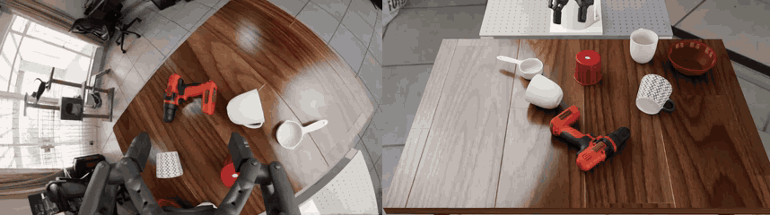
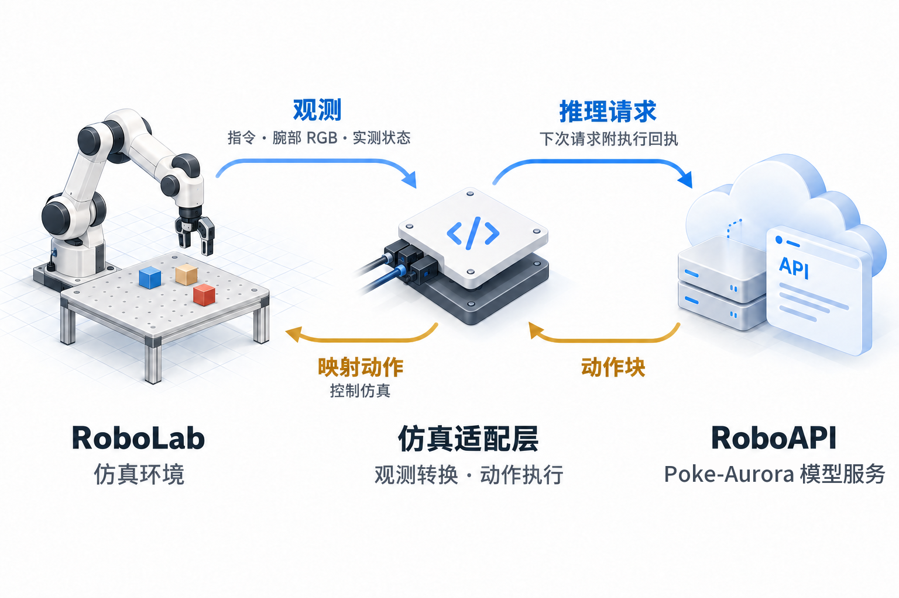

# roboapi-playground

[English](README.md) | **简体中文**

[](https://github.com/huashanjian/roboapi-playground/actions/workflows/roboapi.yml?query=branch%3Amain)
[](LICENSE)

在 Isaac Sim 5.1 中用 [RoboAPI](https://developers.pokebot.com/zh/docs/roboapi/latest) 策略（例如破壳的 Poke-Aurora）运行 [NVIDIA RoboLab](https://github.com/NVLabs/RoboLab) 的 120 个操作任务。机器人为经过标定的 Franka/Robotiq 构型，配腕部鱼眼相机。

策略收到任务指令、一张腕部 RGB 图像、实测的法兰位姿和夹爪开口。仿真适配层执行返回的动作块，并保存每一次观测、响应和执行回执。打开任意一个回合，都能看到策略收到了什么、做了什么。

[任务演示](#任务演示) · [动手试试](#动手试试) · [查看一个回合](#查看一个回合) · [接入自己的模型](#接入自己的模型) · [工作原理](#代码导览) · [文档导航](#文档导航)

<a id="任务演示"></a>

## 🎬 任务演示

### 连续收纳电子设备

> 将电子设备放进灰色收纳箱。


机器人先挪动收纳箱，再抓起鼠标并放入箱中。

<table width="100%">
  <tr>
    <th width="50%">三层魔方堆塔</th>
    <th width="50%">白杯翻正</th>
  </tr>
  <tr>
    <td width="50%"></td>
    <td width="50%"></td>
  </tr>
  <tr>
    <td>“把魔方堆成一座塔。”<br />机器人把三个魔方堆成塔，放置之间会调整抓取。预览为录像的 3 倍速。</td>
    <td>“让所有白杯直立，杯口朝上。”<br />机器人抓住侧倒的白杯，将杯口翻转朝上。</td>
  </tr>
</table>

### 策略看到的画面

> 把白杯叠放在一起。



左：策略收到的腕部相机画面。右：同一回合的外部视角。预览为录像的 4 倍速。想自己运行这个任务，见[运行叠杯任务](#运行演示任务)。

以上为仿真回放节选。每次 API 请求进行期间，仿真时间暂停。

<a id="动手试试"></a>

## 🛝 动手试试

需要 **Python 3.11、Isaac Sim 5.1、Isaac Lab 2.3.2.post1** 和一个 RoboAPI 密钥，不需要实体机器人。按照[安装指南](docs/roboapi/setup.md#from-a-fresh-clone-to-your-first-episode)完成一次安装：安装[标定资产包](https://github.com/huashanjian/roboapi-playground/releases/tag/roboapi-rig-v1.0.0)，配置 `.env.local` 并构建机器人。Panda 几何文件和基准场景另行安装，详见[所需资产](docs/roboapi/setup.md#required-assets)。

在仓库根目录执行预检查，确认机器人、夹爪与相机工作正常。这一步不调用模型：

```bash
policies/roboapi/run.sh --task BananaOnPlateTask --num-runs 1 \
  --preflight-only --output-folder-name roboapi_preflight
```

打开 `output/roboapi_preflight/wrist_initial.png` 检查腕部画面；同一目录下的 `preflight.json` 保存机器人、夹爪和相机的检查结果。

然后运行一个回合：

```bash
policies/roboapi/run.sh --task BananaOnPlateTask --num-runs 1 \
  --output-folder-name roboapi_single
```

回合产物保存在 `output/roboapi_single/`，先看哪些文件见[查看一个回合](#查看一个回合)。其他任务见 [RoboLab 任务目录](robolab/tasks/README.md)。

短时间试运行时，显式指定 `--task` 和 `--num-runs`。两者都省略时，运行器会启动完整评测：全部 120 个任务，每个任务 10 个回合。

<a id="运行演示任务"></a>

### 运行叠杯任务

以下命令以当前配置的模型运行一个叠杯回合：

```bash
policies/roboapi/run.sh --task StackWhiteMugsTask --num-runs 1 --seed 0 \
  --model "$ROBOAPI_MODEL" --output-folder-name mug_example
```

结果保存在 `output/mug_example/`。同一目录中已完成的回合会被跳过，更换模型或标定配置时请换一个目录名。

<a id="查看一个回合"></a>

## 🔬 查看一个回合

运行叠杯任务后，打开 `output/mug_example/StackWhiteMugsTask/run_0_api/observation_0000.png`，这就是第一次查询时发给模型的腕部图像。同一目录下：

- `observation_0000.json`：任务指令、实测位姿（`pose_wxyz`、`native_tool_pose_wxyz`）和 `gripper_open`。
- `chunk_0000.json`：针对这次观测返回的动作，以及转换后的仿真指令。
- `events.jsonl`：每个动作块的执行反馈，以 `request_id` 对应。

<details>
<summary>用 Python 标准库打印这个回合的摘要</summary>

```bash
python - output/mug_example/StackWhiteMugsTask/run_0_api <<'PY'
import json
import sys
from pathlib import Path

episode = Path(sys.argv[1])
summary = json.loads((episode / "summary.json").read_text())
for key in ("model", "resolved_model", "status", "executed_steps", "errors"):
    print(f"{key}: {summary.get(key)}")
chunks = sorted(episode.glob("chunk_*.json"))
if chunks:
    path = chunks[0]
    chunk = json.loads(path.read_text())
    obs = json.loads((episode / path.name.replace("chunk_", "observation_")).read_text())
    print("Measured opening before chunk:", obs["gripper_open"])
    print("First requested opening:", chunk["gripper_open"][0])
    print("Returned actions:", len(chunk["sim_actions"]))
    print("Simulated seconds per action:", chunk["action_dt_s"])
    print("Request ID:", chunk["request_id"])
else:
    print("No action chunk was saved; check status and errors above.")
PY
```

</details>

在 `events.jsonl` 中找到相同 `request_id` 的 `execution_feedback` 条目，可以看到实际执行步数以及动作块是否完成。下一编号的观测记录该动作块之后测得的状态。`summary.json` 中的 `status` 表示 API 客户端的运行状态，任务是否成功记录在本次运行的 `episode_results.jsonl` 中。

<a id="代码导览"></a>

## 🗺️ 工作原理

仿真适配层向 RoboAPI 服务发送 RoboLab 观测，把返回的动作转换到仿真坐标系，并反馈执行情况：

<p align="center">
  
</p>

策略只看到腕部图像、指令和实测状态，并返回一个动作块。[`client.py`](policies/roboapi/client.py) 按下表打包和解析这些数据：

| 数据 | 表示方式 |
| --- | --- |
| 腕部图像 | 一张 360 × 640 × 3 的 `uint8` RGB 图像，编码为 PNG data URL |
| 指令 | 任务的文字指令 |
| 实测状态 | `tool0`（法兰中心）位置（米）、姿态与夹爪开口比例 |
| 返回的动作块 | K × 8 个数值，API 传输顺序为 `[x, y, z, qx, qy, qz, qw, gripper]` |

按照 [RoboAPI 模型接口协议](https://developers.pokebot.com/zh/docs/roboapi/latest/model-contract)，每个动作给出工具的**绝对位姿**和夹爪开口比例（`0` 为闭合，`1` 为张开），K 由服务端决定。适配器内部的位姿和归档的 `sim_actions` 使用 **WXYZ** 四元数顺序，`transport.py` 负责与 API 的 **XYZW** 顺序互相转换。

| 文件 | 对应实现 |
| --- | --- |
| [`run.py`](policies/roboapi/run.py) | 预检查、回合执行与运行配置记录 |
| [`client.py`](policies/roboapi/client.py) | 观测与动作的坐标变换、动作块和执行反馈 |
| [`transport.py`](policies/roboapi/transport.py) | 模型查询、HTTP 请求、会话与响应校验 |
| [`build_asset.py`](policies/roboapi/build_asset.py) | 将 Franka、Robotiq 与相机组装为 USD 资产 |
| [`registration.py`](policies/roboapi/registration.py) | 环境注册与以 tool0 为控制对象的逆运动学配置 |
| [`camera.py`](policies/roboapi/camera.py) | 鱼眼相机模型、渲染设置与运行时检查 |
| [`arm_action.py`](policies/roboapi/arm_action.py) | 机械臂逆运动学、tool0 雅可比修正和工具负载补偿 |
| [`gripper_response.py`](policies/roboapi/gripper_response.py) | 夹爪延迟、响应限制和测量采样 |

<a id="设计说明"></a>
<a id="接入说明"></a>

### 各部分如何衔接

**位姿。** API 给出的目标位姿作用于法兰中心的 `tool0`。策略坐标系与机器人基坐标系原点重合，绕 Z 轴旋转：

```text
T_policy = Rz(-90°) @ T_robot_tool0
T_robot_tool0 = Rz(+90°) @ T_policy
```

例如，机器人坐标系中的位置 `(0.3, 0.1, 0.4)` 米，在策略坐标系中为 `(0.1, -0.3, 0.4)` 米。工具安装、逆运动学和负载补偿见[控制说明](docs/roboapi/control.md)。

**动作块。** 运行器以 **30 Hz** 逐行执行返回的动作块，每行推进八个 **240 Hz** 物理步；执行完毕后发送新观测，并附上已执行行数的回执。一个 12 行的动作块对应 0.4 秒仿真时间。会话协议见[协议与评测](docs/roboapi/evaluation.md)。

**标定。** 相机使用资产包中的原生 F-theta 鱼眼光学参数渲染，适配器直接发送渲染出的图像。夹爪的延迟、更新周期和速度限制来自执行器标定，观测上报测得的开口比例。字段格式见[资产输入约定](docs/roboapi/setup.md#input-contract)。

<a id="运行记录与评测"></a>

## 🧾 运行记录与评测

在 `output/<run-name>/` 下，`manifest.json` 记录代码与依赖版本、请求的模型与 API 地址、任务与随机种子列表、相机设置及机器人组件信息。`episode_results.jsonl` 保存各回合结果。

每个回合还会在 `<task>/run_<n>_api/` 下保存：

| 文件 | 内容 |
| --- | --- |
| `observation_*.png` 与 `observation_*.json` | 腕部图像、指令、测得的位姿与夹爪开口比例 |
| `chunk_*.json` | 返回的位姿与夹爪动作块、转换后的仿真动作、请求与会话标识 |
| `events.jsonl` 与 `summary.json` | 执行反馈、已完成的步数、耗时、错误和服务端解析后的实际模型 |

预检查使用独立的输出目录。检查安装时，先看其中的 `preflight.json`、`wrist_initial.png` 和 `runtime_camera.json`。

运行器覆盖全部 **120 个 RoboLab 任务定义**。每回合最长 **120 秒仿真时间**、最多 **90 个动作块**，判定成功时提前结束。用[完整评测工具](docs/roboapi/evaluation.md#complete-evaluation-tools)可以调度全部任务并汇总结果；与其他 RoboLab 结果对比时，请注明[评测条件](docs/roboapi/evaluation.md#evaluation-conditions)。

<a id="修改与扩展"></a>
<a id="接入自己的模型"></a>

## 🛠️ 接入自己的模型

### 使用兼容 RoboAPI 的服务

实现了 [RoboAPI 模型接口协议](https://developers.pokebot.com/zh/docs/roboapi/latest/model-contract)的服务，只需修改配置。在 `.env.local` 中设置服务地址和模型 ID：

```dotenv
ROBOAPI_BASE_URL=<service-base-url>
ROBOAPI_MODEL=<model-id>
```

执行 `set -a; source .env.local; set +a` 重新加载，再用新的 `--output-folder-name` 运行回合命令。使用模型别名时，会话在创建时固定一个实际版本，可对照 `manifest.json` 中请求的 `model` 与 `summary.json` 中的 `resolved_model`。

### 适配其他模型接口

模型的输入或输出不同时，从下表的位置改起：

| 要改什么 | 从哪里开始 |
| --- | --- |
| 发给模型的字段 | [`client.py`](policies/roboapi/client.py) 的 `_extract_observation` |
| 返回动作如何转成仿真动作 | [`client.py`](policies/roboapi/client.py) 的 `_unpack_response` |
| 请求、会话与执行回执 | [`transport.py`](policies/roboapi/transport.py) |
| 仿真观测与控制配置 | [`registration.py`](policies/roboapi/registration.py) |

这些接口之间的四元数顺序、坐标系和步进后确认逻辑需要保持一致。[离线检查](#测试)中，`test_roboapi_client.py` 覆盖坐标变换与动作块执行，`test_roboapi_transport.py` 覆盖会话与回执，`test_roboapi_response.py` 和 `test_roboapi_gripper.py` 覆盖夹爪响应及实测反馈。涉及渲染视角或物理跟踪的修改，还需要运行仿真预检查和新的任务回合。

### 调整机器人配置

**相机或夹爪标定。** 用 `ROBOAPI_CALIBRATION` 和 `ROBOAPI_ACTUATOR` 指向自己的标定文件；更换相机组件时，同步设置 `ROBOAPI_ASSEMBLY_USD` 和 `ROBOAPI_CAMERA_PRIM`。重新加载配置后，执行 `"$ROBOAPI_PYTHON" -m policies.roboapi.build_asset` 重建机器人，再用新的输出目录运行预检查。确认腕部图像、运行时相机变换和 `gripper_validation` 正常后，再运行新回合。

<a id="测试"></a>

### 运行离线检查

在独立的 Python 环境中执行：

```bash
python -m pip install -r requirements-roboapi-tests.txt
scripts/test_roboapi.sh
```

这些检查无需 Isaac Sim，也不调用模型。安装 PyTorch 后，还会在 CPU 上测试夹爪动作缓冲区。

<a id="排错"></a>

## 🩹 排错

| 现象 | 先检查什么 |
| --- | --- |
| 腕部相机画面异常 | 对照预检查的 `wrist_initial.png`、`runtime_camera.json` 与回合中的 `observation_*.png`。检查相机路径、原生镜头支持，以及 [`camera.py`](policies/roboapi/camera.py) 中的渲染设置。 |
| 机械臂接近了错误位置 | 对照 `observation_*.json` 中的原生位姿与策略坐标系位姿，以及 `chunk_*.json` 中的 `sim_actions`。检查 [`client.py`](policies/roboapi/client.py) 的坐标变换与预检查中的工具中心点（TCP）跟踪结果。 |
| 夹爪松开或频繁调整 | 对照 `chunk_*.json` 中返回的开合指令与 `observation_*.json` 中测得的开口比例。查看预检查的 `gripper_validation`，再检查[响应模型](policies/roboapi/gripper_response.py)和[仿真关节控制](policies/roboapi/gripper_action.py)。 |
| 仿真能运行，但 API 调用失败 | 检查 `ROBOAPI_TOKEN_FILE` 及 [`.env.example`](.env.example) 中的 API 地址、模型设置。查看回合的 `summary.json` 和已有的 `http_*_response.json`；会话与响应校验在 [`transport.py`](policies/roboapi/transport.py) 中。 |

## 文档导航

- [安装、本地配置与标定资产](docs/roboapi/setup.md)
- [坐标系、机械臂与夹爪控制](docs/roboapi/control.md)
- [RoboAPI 协议与评测](docs/roboapi/evaluation.md)
- [RoboLab 任务目录](robolab/tasks/README.md)

<a id="致谢与许可证"></a>

## 🙏 致谢与许可证

本仓库最初从 [NVIDIA RoboLab](https://github.com/NVLabs/RoboLab) 分出，现在独立维护，原样使用其任务定义、回合执行流程和成功判定，并通过 [RoboAPI](https://developers.pokebot.com/zh/docs/roboapi/latest) 接口调用机器人策略。

代码采用 [Apache 2.0 许可证](LICENSE)，保留上游历史与 NVIDIA 版权声明。机器人、工具和基准资产各自遵循其原有许可证，详见[第三方声明](THIRD_PARTY_NOTICES.md)。

`upstream-main` 分支是上次同步时 NVIDIA RoboLab `main` 分支的副本。

## Star History

<a href="https://www.star-history.com/?repos=huashanjian%2Froboapi-playground&amp;type=date&amp;legend=top-left">
  <picture>
    <source media="(prefers-color-scheme: dark)" srcset="https://api.star-history.com/chart?repos=huashanjian/roboapi-playground&amp;type=date&amp;theme=dark&amp;legend=top-left" />
    <source media="(prefers-color-scheme: light)" srcset="https://api.star-history.com/chart?repos=huashanjian/roboapi-playground&amp;type=date&amp;legend=top-left" />
    
  </picture>
</a>
