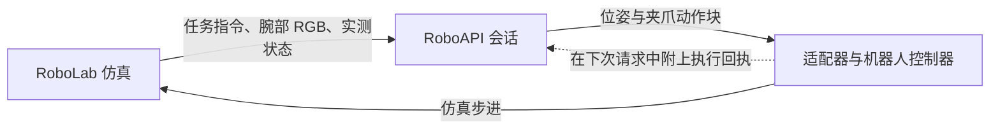

# roboapi-playground

[English](README.md) | **简体中文**

[](https://github.com/huashanjian/roboapi-playground/actions/workflows/roboapi.yml?query=branch%3Afeat%2Froboapi-eval)
[](LICENSE)

使用经过标定的 Franka/Robotiq 机器人和腕部鱼眼相机，在 [NVIDIA RoboLab](https://github.com/NVLabs/RoboLab) 操作任务中运行 [RoboAPI](https://developers.pokebot.com/docs/roboapi/latest) 策略。

本分支加入了 RoboAPI 推理适配器、机器人组件构建工具和执行日志，沿用 RoboLab 的任务定义、回合执行流程和成功判定。

[任务演示](#-任务演示) · [动手试试](#-动手试试) · [代码导览](#-代码导览) · [运行记录与评测](#-运行记录与评测) · [文档导航](#文档导航)

## 🎬 任务演示

### 连续收纳电子设备

> 将电子设备放进灰色收纳箱。


机器人先挪动收纳箱，再抓起鼠标并放入箱中。

<table width="100%">
  <tr>
    <th width="50%">三层魔方堆塔</th>
    <th width="50%">白杯翻正</th>
  </tr>
  <tr>
    <td width="50%"></td>
    <td width="50%"></td>
  </tr>
  <tr>
    <td>“把魔方堆成一座塔。”<br />预览为录像的 3 倍速。</td>
    <td>“让所有白杯直立，杯口朝上。”</td>
  </tr>
</table>

以上为仿真回放节选，录像时长不含等待 API 响应的时间。画面采用外部观察视角，策略实际接收的是腕部相机图像。

## 🛝 动手试试

需要 **Python 3.11、Isaac Sim 5.1 和 Isaac Lab 2.3.2.post1**。先按照[安装指南](docs/roboapi/setup.md#from-a-fresh-clone-to-your-first-episode)克隆当前分支，安装[标定资产包](https://github.com/huashanjian/roboapi-playground/releases/tag/roboapi-rig-v1.0.0)，配置 `.env.local` 并构建机器人。

在仓库根目录执行预检查，确认机器人、夹爪与相机可以正常运行；这一步不调用模型：

```bash
policies/roboapi/run.sh --task BananaInBowlTask --num-runs 1 \
  --preflight-only --output-folder-name roboapi_preflight
```

配置 API 密钥后，运行一个回合：

```bash
policies/roboapi/run.sh --task BananaInBowlTask --num-runs 1 \
  --output-folder-name roboapi_single
```

预检查报告位于 `output/roboapi_preflight/preflight.json`，回合产物保存在 `output/roboapi_single/`。想试上面的电子设备收纳任务，可以将 `BananaInBowlTask` 换成 `ElectronicsInBinTask`。其他任务见 [RoboLab 任务目录](robolab/tasks/README.md)。

短时间试运行时，显式指定 `--task` 和 `--num-runs`。两者均省略时，常规评测默认对全部 120 个任务各运行 10 个回合；同一输出目录中已完成的回合会被跳过。

## 🗺️ 代码导览

适配器将 RoboLab 观测组织为 RoboAPI 请求，把返回的动作转换到仿真坐标系，并反馈执行情况：



- **观测：** 单张腕部 RGB 图像、任务指令、测得的工具位姿和夹爪开口宽度。模型不接收物体状态或任务特权观测。
- **相机与坐标：** 使用原生 `OmniLensDistortionFthetaAPI` 鱼眼相机模型及标定后的工具到相机变换，将针对 1280 × 720 图像标定的相机内参，缩放到策略接收的 640 × 360 图像尺寸。
- **控制：** 返回的动作块驱动机械臂逆运动学控制和经过标定的 Robotiq 响应模型。反馈给策略的是测得的夹爪开口宽度，不是上一次请求的开合指令。

| 文件 | 对应实现 |
| --- | --- |
| [`run.py`](policies/roboapi/run.py) | 预检查、回合执行与运行配置记录 |
| [`client.py`](policies/roboapi/client.py) | 观测与动作的坐标变换、动作块和执行反馈 |
| [`transport.py`](policies/roboapi/transport.py) | 模型查询、HTTP 请求、会话与响应校验 |
| [`build_asset.py`](policies/roboapi/build_asset.py) | 将 Franka、Robotiq 与相机组装为 USD 资产 |
| [`registration.py`](policies/roboapi/registration.py) | 环境注册与以 tool0 为控制对象的逆运动学配置 |
| [`camera.py`](policies/roboapi/camera.py) | 鱼眼相机模型、渲染设置与运行时检查 |
| [`arm_action.py`](policies/roboapi/arm_action.py) | 机械臂逆运动学、tool0 雅可比修正和工具负载补偿 |
| [`gripper_response.py`](policies/roboapi/gripper_response.py) | 夹爪延迟、响应限制和测量采样 |

坐标约定、工具负载补偿与夹爪动态响应详见[控制说明](docs/roboapi/control.md)。

## 🧾 运行记录与评测

在 `output/<run-name>/` 下，`manifest.json` 记录代码与依赖版本、请求的模型与 API 地址、任务与随机种子列表、相机设置及机器人组件信息。`episode_results.jsonl` 保存各回合结果。

每个回合还会在 `<task>/run_<n>_api/` 下保存：

| 文件 | 内容 |
| --- | --- |
| `observation_*.png` 与 `observation_*.json` | 腕部图像、指令、测得的位姿与夹爪开口宽度 |
| `chunk_*.json` | 返回的位姿与夹爪动作块、转换后的仿真动作、请求与会话标识 |
| `events.jsonl` 与 `summary.json` | 执行反馈、已完成的步数、耗时、错误和服务端解析后的实际模型 |

预检查使用独立的输出目录。检查安装时，先看其中的 `preflight.json`、`wrist_initial.png` 和 `runtime_camera.json`。

运行器支持 **120 个 RoboLab 任务定义**，每回合统一采用 **120 秒仿真时长**，最多执行 **90 个动作块**。GIF 展示选取的运行片段，仓库尚未包含完整任务集的成功率或模型对比结果。机器人、相机与时限设置见[评测条件](docs/roboapi/evaluation.md#evaluation-conditions)，批量执行与结果汇总见[完整评测工具](docs/roboapi/evaluation.md#complete-evaluation-tools)。

## 🩹 排错

| 现象 | 先检查什么 |
| --- | --- |
| 腕部相机画面异常 | 对照预检查的 `wrist_initial.png`、`runtime_camera.json` 与回合中的 `observation_*.png`。检查相机路径、原生镜头支持，以及 [`camera.py`](policies/roboapi/camera.py) 中的渲染设置。 |
| 机械臂接近了错误位置 | 对照 `observation_*.json` 中的原生位姿与策略坐标系位姿，以及 `chunk_*.json` 中的 `sim_actions`。检查 [`client.py`](policies/roboapi/client.py) 的坐标变换与预检查中的工具中心点（TCP）跟踪结果。 |
| 夹爪松开或频繁调整 | 对照 `chunk_*.json` 中返回的开合指令与 `observation_*.json` 中测得的开口宽度。查看预检查的 `gripper_validation`，再检查[响应模型](policies/roboapi/gripper_response.py)和[仿真关节控制](policies/roboapi/gripper_action.py)。 |
| 仿真能运行，但 API 调用失败 | 检查 `ROBOAPI_TOKEN_FILE` 及 [`.env.example`](.env.example) 中的 API 地址、模型设置。查看回合的 `summary.json` 和已有的 `http_*_response.json`；会话与响应校验在 [`transport.py`](policies/roboapi/transport.py) 中。 |

<details>
<summary>环境与资产问题</summary>

**需要实体机器人吗？** 不需要，这些任务在 Isaac Sim 中运行。

**标定资产包包含什么？** 工具组件、相机和执行器标定文件。Panda 几何文件、基准场景和仿真器需要另行准备，详见[所需资产](docs/roboapi/setup.md#required-assets)。

**可以更换模型吗？** 在 `.env.local` 中设置 `ROBOAPI_MODEL` 和 `ROBOAPI_BASE_URL`。API 服务须实现 [RoboAPI 模型接口协议](https://developers.pokebot.com/docs/roboapi/latest/model-contract)。

</details>

## 测试

在独立的 Python 环境中运行离线检查：

```bash
python -m pip install -r requirements-roboapi-tests.txt
scripts/test_roboapi.sh
```

这些检查无需 Isaac Sim，也不调用模型。安装 PyTorch 后，还会在 CPU 上测试夹爪动作缓冲区。

## 文档导航

- [安装、本地配置与标定资产](docs/roboapi/setup.md)
- [坐标系、机械臂与夹爪控制](docs/roboapi/control.md)
- [RoboAPI 协议与评测](docs/roboapi/evaluation.md)
- [RoboLab 任务目录](robolab/tasks/README.md)

## 🙏 致谢与许可证

本项目基于 [NVIDIA RoboLab](https://github.com/NVLabs/RoboLab)，通过 [RoboAPI](https://developers.pokebot.com/docs/roboapi/latest) 接口调用机器人策略。

代码采用 [Apache 2.0 许可证](LICENSE)，保留上游历史与 NVIDIA 版权声明。机器人、工具和基准资产各自遵循其原有许可证，详见[第三方声明](THIRD_PARTY_NOTICES.md)。

## Star History

<a href="https://www.star-history.com/?repos=huashanjian%2Froboapi-playground&amp;type=date&amp;legend=top-left">
  <picture>
    <source media="(prefers-color-scheme: dark)" srcset="https://api.star-history.com/chart?repos=huashanjian/roboapi-playground&amp;type=date&amp;theme=dark&amp;legend=top-left" />
    <source media="(prefers-color-scheme: light)" srcset="https://api.star-history.com/chart?repos=huashanjian/roboapi-playground&amp;type=date&amp;legend=top-left" />
    
  </picture>
</a>
