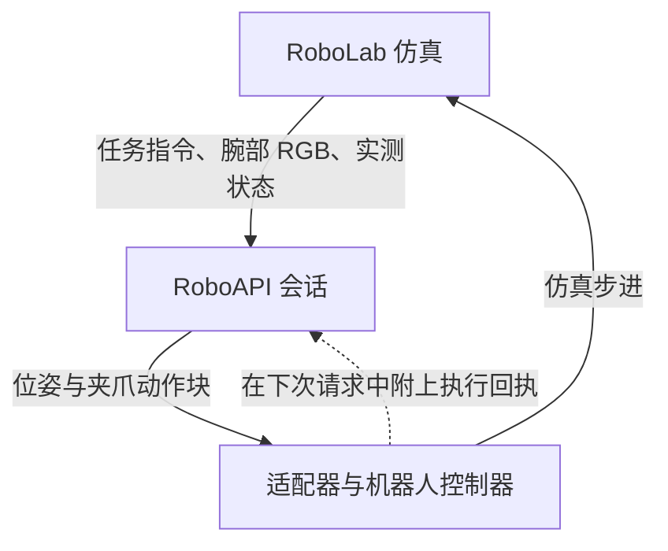

# roboapi-playground

[English](README.md) | **简体中文**

[](https://github.com/huashanjian/roboapi-playground/actions/workflows/roboapi.yml?query=branch%3Afeat%2Froboapi-eval)
[](LICENSE)

使用经过标定的 Franka/Robotiq 机器人和腕部鱼眼相机，在 [NVIDIA RoboLab](https://github.com/NVLabs/RoboLab) 操作任务中运行 [RoboAPI](https://developers.pokebot.com/docs/roboapi/latest) 策略。

本分支加入了 RoboAPI 推理适配器、机器人组件构建工具和执行日志，沿用 RoboLab 的任务定义、回合执行流程和成功判定。

[任务演示](#任务演示) · [动手试试](#动手试试) · [运行演示任务](#运行演示任务) · [代码导览](#代码导览)

[设计说明](#设计说明) · [查看一个回合](#查看一个回合) · [修改与扩展](#修改与扩展) · [文档导航](#文档导航)

<a id="任务演示"></a>

## 🎬 任务演示

### 连续收纳电子设备

> 将电子设备放进灰色收纳箱。


机器人先挪动收纳箱，再抓起鼠标并放入箱中。

<table width="100%">
  <tr>
    <th width="50%">三层魔方堆塔</th>
    <th width="50%">白杯翻正</th>
  </tr>
  <tr>
    <td width="50%"></td>
    <td width="50%"></td>
  </tr>
  <tr>
    <td>“把魔方堆成一座塔。”<br />预览为录像的 3 倍速。</td>
    <td>“让所有白杯直立，杯口朝上。”</td>
  </tr>
</table>

以上为仿真回放节选，录像时长不含等待 API 响应的时间。画面采用外部观察视角，策略实际接收的是腕部相机图像。

<a id="动手试试"></a>

## 🛝 动手试试

需要 **Python 3.11、Isaac Sim 5.1 和 Isaac Lab 2.3.2.post1**。先按照[安装指南](docs/roboapi/setup.md#from-a-fresh-clone-to-your-first-episode)克隆当前分支，安装[标定资产包](https://github.com/huashanjian/roboapi-playground/releases/tag/roboapi-rig-v1.0.0)，配置 `.env.local` 并构建机器人。

在仓库根目录执行预检查，确认机器人、夹爪与相机可以正常运行；这一步不调用模型：

```bash
policies/roboapi/run.sh --task BananaInBowlTask --num-runs 1 \
  --preflight-only --output-folder-name roboapi_preflight
```

配置 API 密钥后，运行一个回合：

```bash
policies/roboapi/run.sh --task BananaInBowlTask --num-runs 1 \
  --output-folder-name roboapi_single
```

预检查报告位于 `output/roboapi_preflight/preflight.json`，回合产物保存在 `output/roboapi_single/`。其他任务见 [RoboLab 任务目录](robolab/tasks/README.md)。

短时间试运行时，显式指定 `--task` 和 `--num-runs`。两者均省略时，常规评测默认对全部 120 个任务各运行 10 个回合；同一输出目录中已完成的回合会被跳过。

<a id="运行演示任务"></a>

## 🧾 运行演示任务

完成安装并加载 `.env.local` 后，用以下命令分别运行三个展示任务。每个任务运行一个新回合，随机种子为 0，使用当前配置的模型：

```bash
policies/roboapi/run.sh --task ElectronicsInBinTask --num-runs 1 --seed 0 \
  --model "$ROBOAPI_MODEL" --output-folder-name electronics_example
policies/roboapi/run.sh --task Stack3RubiksCubeTask --num-runs 1 --seed 0 \
  --model "$ROBOAPI_MODEL" --output-folder-name stacking_example
policies/roboapi/run.sh --task ReorientWhiteMugsTask --num-runs 1 --seed 0 \
  --model "$ROBOAPI_MODEL" --output-folder-name mug_example
```

结果保存在 `output/` 下对应的三个目录中。随机种子控制回合中的随机数生成；这些任务仍沿用 RoboLab 的固定物体布局。更换模型或标定配置时，使用新的输出目录名。

三个 GIF 对应的原始随机种子、实际模型版本与回合日志尚未公开。以上命令按当前配置运行相同任务，不代表原录像的运行条件。

<a id="代码导览"></a>

## 🗺️ 代码导览

适配器将 RoboLab 观测组织为 RoboAPI 请求，把返回的动作转换到仿真坐标系，并反馈执行情况：



[`client.py`](policies/roboapi/client.py) 连接以下观测与动作。物体状态和任务特权观测留在仿真端。

| 数据 | 表示方式 |
| --- | --- |
| 腕部图像 | 一张 360 × 640 × 3 的 `uint8` RGB 图像，编码为 PNG data URL |
| 指令 | 任务的文字指令 |
| 实测状态 | 工具位置（米）、姿态与夹爪开口比例 |
| 返回的动作块 | K × 8 个数值，API 传输顺序为 `[x, y, z, qx, qy, qz, qw, gripper]` |

每个动作给出工具的**绝对位姿**和夹爪开口比例（`0` 为闭合，`1` 为张开）。K 由服务端决定。适配器内部位姿和归档的 `sim_actions` 使用 **WXYZ** 四元数顺序，`transport.py` 负责与 API 的 **XYZW** 顺序互相转换。

| 文件 | 对应实现 |
| --- | --- |
| [`run.py`](policies/roboapi/run.py) | 预检查、回合执行与运行配置记录 |
| [`client.py`](policies/roboapi/client.py) | 观测与动作的坐标变换、动作块和执行反馈 |
| [`transport.py`](policies/roboapi/transport.py) | 模型查询、HTTP 请求、会话与响应校验 |
| [`build_asset.py`](policies/roboapi/build_asset.py) | 将 Franka、Robotiq 与相机组装为 USD 资产 |
| [`registration.py`](policies/roboapi/registration.py) | 环境注册与以 tool0 为控制对象的逆运动学配置 |
| [`camera.py`](policies/roboapi/camera.py) | 鱼眼相机模型、渲染设置与运行时检查 |
| [`arm_action.py`](policies/roboapi/arm_action.py) | 机械臂逆运动学、tool0 雅可比修正和工具负载补偿 |
| [`gripper_response.py`](policies/roboapi/gripper_response.py) | 夹爪延迟、响应限制和测量采样 |

<a id="设计说明"></a>

## 🧩 设计说明

### 策略控制的是机器人上的哪个点？

控制对象是位于法兰中心的 `tool0`，目标位姿对应这个原点，而非指尖。构建工具将末端工具、夹爪和相机作为整体，安装位置沿 `panda_link7` 的局部 Z 轴偏移 107 mm，安装姿态绕 Z 轴旋转 +90°。测得的 `tool0` 位姿已经包含这个装配变换。

策略基坐标系与机器人基坐标系的原点重合，坐标轴方向不同。[`tool_to_policy_pose`](policies/roboapi/client.py) 对 4 × 4 位姿变换矩阵作左乘，转换参考坐标系：

```text
T_policy = Rz(-90°) @ T_robot_tool0
T_robot_tool0 = Rz(+90°) @ T_policy
```

例如，位置 `(0.3, 0.1, 0.4)` 米转换后为 `(0.1, -0.3, 0.4)` 米，姿态也随参考系一起旋转。如果再应用一次装配旋转，就会把已装配的工具多转一次；返回动作只需做上述逆变换。[坐标测试](tests/test_roboapi_client.py) 覆盖双向转换和装配旋转不重复应用的情况。

机械臂逆运动学还需要控制点处的雅可比矩阵。PhysX 给出的是刚体质心处的雅可比矩阵，[`arm_action.py`](policies/roboapi/arm_action.py) 将它转换到 `tool0` 原点，并补偿附加工具的重力负载。具体公式和关节设置见[控制说明](docs/roboapi/control.md)。

### 策略什么时候接收下一次观测？

适配器请求一个动作块，按顺序执行各行，再带着新观测请求下一个动作块。例如，在 **30 Hz** 控制频率下，一个 12 步动作块对应 0.4 秒仿真时间，每个动作推进八个 **240 Hz** 物理步。动作块长度可变，客户端不将它裁成固定长度。等待 API 响应期间，仿真时间暂停，因此回放速度不包含网络等待时间。

[`run.py`](policies/roboapi/run.py) 只在 `env.step` 成功返回后确认一个动作已执行。动作块结束时，`client.py` 记录完成步数，`transport.py` 在下次请求中将执行回执与新观测一起发送。如果回合在动作块中途结束，回执记录已执行的前缀，并将该块标为中断。因此，收到一个动作块并不表示其中的动作全部执行完毕。

### 为什么要保留相机和夹爪的响应特性？

腕部相机随工具运动。安装外参决定相机能看到什么，原生 F-theta 鱼眼模型决定图像怎样投影。渲染器保留组件中的 `OmniLensDistortionFthetaAPI` 光学设置。针对 640 × 360 输入，将标定文件中 `K_1280x720` 的前两行缩放为一半；畸变系数和外参不缩放。图像不再额外裁剪、旋转或去畸变，具体实现见 [`camera.py`](policies/roboapi/camera.py)。

夹爪指令给出期望开口，并不使关节瞬间到达该位置。[`gripper_response.py`](policies/roboapi/gripper_response.py) 依次处理命令延迟、目标更新周期、一阶响应，以及张开和闭合各自的速度限制。**v1.0.0 资产包的标定参数**采用 100 ms 命令延迟、50 ms 目标更新周期和 150 ms 编码器采样周期，量化步长为一个原始编码器计数。

反馈从仿真主关节的实测位置出发，再经过上述编码器模型。由于响应滞后、接触或采样间隔，闭合指令与下一次上报的开口可能不同。如果直接把上一条指令作为观测发回，策略就无法看到这种差异。

<a id="运行记录与评测"></a>

## 🧾 运行记录与评测

在 `output/<run-name>/` 下，`manifest.json` 记录代码与依赖版本、请求的模型与 API 地址、任务与随机种子列表、相机设置及机器人组件信息。`episode_results.jsonl` 保存各回合结果。

每个回合还会在 `<task>/run_<n>_api/` 下保存：

| 文件 | 内容 |
| --- | --- |
| `observation_*.png` 与 `observation_*.json` | 腕部图像、指令、测得的位姿与夹爪开口比例 |
| `chunk_*.json` | 返回的位姿与夹爪动作块、转换后的仿真动作、请求与会话标识 |
| `events.jsonl` 与 `summary.json` | 执行反馈、已完成的步数、耗时、错误和服务端解析后的实际模型 |

预检查使用独立的输出目录。检查安装时，先看其中的 `preflight.json`、`wrist_initial.png` 和 `runtime_camera.json`。

运行器支持 **120 个 RoboLab 任务定义**，每回合统一采用 **120 秒仿真时长**，最多执行 **90 个动作块**。GIF 展示选取的运行片段，仓库尚未包含完整任务集的成功率或模型对比结果。机器人、相机与时限设置见[评测条件](docs/roboapi/evaluation.md#evaluation-conditions)，批量执行与结果汇总见[完整评测工具](docs/roboapi/evaluation.md#complete-evaluation-tools)。

<a id="查看一个回合"></a>

## 🔬 查看一个回合

运行电子设备收纳示例后，打开 `output/electronics_example/ElectronicsInBinTask/run_0_api/observation_0000.png`，这就是第一次查询时发给模型的腕部图像。同名 JSON 保存 `pose_wxyz`、`native_tool_pose_wxyz`、`gripper_open` 和任务指令。如果查询成功，`chunk_0000.json` 保存针对这次观测返回的动作块。

在仓库根目录执行以下命令，用 Python 标准库查看这个回合：

```bash
python - output/electronics_example/ElectronicsInBinTask/run_0_api <<'PY'
import json
import sys
from pathlib import Path

episode = Path(sys.argv[1])
summary = json.loads((episode / "summary.json").read_text())
for key in ("model", "resolved_model", "status", "executed_steps", "errors"):
    print(f"{key}: {summary.get(key)}")
chunks = sorted(episode.glob("chunk_*.json"))
if chunks:
    path = chunks[0]
    chunk = json.loads(path.read_text())
    obs = json.loads((episode / path.name.replace("chunk_", "observation_")).read_text())
    print("Measured opening before chunk:", obs["gripper_open"])
    print("First requested opening:", chunk["gripper_open"][0])
    print("Returned actions:", len(chunk["sim_actions"]))
    print("Simulated seconds per action:", chunk["action_dt_s"])
    print("Request ID:", chunk["request_id"])
else:
    print("No action chunk was saved; check status and errors above.")
PY
```

在 `events.jsonl` 中找到相同 `request_id` 的 `execution_feedback` 条目，可以看到实际执行步数以及动作块是否完成。若继续发起查询，下一编号的观测就记录该动作块之后测得的状态。`summary.json` 中的 `status` 表示 API 客户端的运行状态；任务是否成功另存于本次运行的 `episode_results.jsonl`。

<a id="修改与扩展"></a>

## 🛠️ 修改与扩展

**更换模型。** 在 `.env.local` 中设置 `ROBOAPI_MODEL`，需要时同时修改 `ROBOAPI_BASE_URL`，然后执行 `set -a; source .env.local; set +a` 重新加载，再启动新进程。服务须实现 [RoboAPI 模型接口协议](https://developers.pokebot.com/docs/roboapi/latest/model-contract)。使用模型别名时，会话在创建时解析并固定实际版本。可对照 `manifest.json` 中请求的 `model` 与 `summary.json` 中的 `resolved_model`。

**调整相机或夹爪标定。** 用 `ROBOAPI_CALIBRATION` 和 `ROBOAPI_ACTUATOR` 指向自己的标定文件；更换相机组件时，还要同步设置 `ROBOAPI_ASSEMBLY_USD` 和 `ROBOAPI_CAMERA_PRIM`。重新加载配置后，执行 `"$ROBOAPI_PYTHON" -m policies.roboapi.build_asset` 重建机器人，再用新的输出目录运行预检查。查看腕部图像、运行时相机变换和 `gripper_validation`，之后再运行新回合。[资产输入约定](docs/roboapi/setup.md#input-contract) 列出了 JSON 字段和 USD 结构；只改 JSON 路径不会更新已构建的机器人。

**修改适配器。** 数据映射从 `client.py` 的 `_extract_observation` 和 `_unpack_response` 入手，会话协议在 `transport.py`，仿真观测与控制配置在 `registration.py`。这些接口之间的四元数顺序、坐标系和步进后确认逻辑需要保持一致。[离线检查](#测试)中，`test_roboapi_client.py` 覆盖坐标变换与动作块执行，`test_roboapi_transport.py` 覆盖会话与回执，`test_roboapi_response.py` 和 `test_roboapi_gripper.py` 覆盖夹爪响应及实测反馈。涉及渲染视角或物理跟踪的修改，还需要运行仿真预检查和新的任务回合。

<a id="排错"></a>

## 🩹 排错

| 现象 | 先检查什么 |
| --- | --- |
| 腕部相机画面异常 | 对照预检查的 `wrist_initial.png`、`runtime_camera.json` 与回合中的 `observation_*.png`。检查相机路径、原生镜头支持，以及 [`camera.py`](policies/roboapi/camera.py) 中的渲染设置。 |
| 机械臂接近了错误位置 | 对照 `observation_*.json` 中的原生位姿与策略坐标系位姿，以及 `chunk_*.json` 中的 `sim_actions`。检查 [`client.py`](policies/roboapi/client.py) 的坐标变换与预检查中的工具中心点（TCP）跟踪结果。 |
| 夹爪松开或频繁调整 | 对照 `chunk_*.json` 中返回的开合指令与 `observation_*.json` 中测得的开口比例。查看预检查的 `gripper_validation`，再检查[响应模型](policies/roboapi/gripper_response.py)和[仿真关节控制](policies/roboapi/gripper_action.py)。 |
| 仿真能运行，但 API 调用失败 | 检查 `ROBOAPI_TOKEN_FILE` 及 [`.env.example`](.env.example) 中的 API 地址、模型设置。查看回合的 `summary.json` 和已有的 `http_*_response.json`；会话与响应校验在 [`transport.py`](policies/roboapi/transport.py) 中。 |

<details>
<summary>环境与资产问题</summary>

**需要实体机器人吗？** 不需要，这些任务在 Isaac Sim 中运行。

**标定资产包包含什么？** 工具组件、相机和执行器标定文件。Panda 几何文件、基准场景和仿真器需要另行准备，详见[所需资产](docs/roboapi/setup.md#required-assets)。

</details>

## 测试

在独立的 Python 环境中运行离线检查：

```bash
python -m pip install -r requirements-roboapi-tests.txt
scripts/test_roboapi.sh
```

这些检查无需 Isaac Sim，也不调用模型。安装 PyTorch 后，还会在 CPU 上测试夹爪动作缓冲区。

## 文档导航

- [安装、本地配置与标定资产](docs/roboapi/setup.md)
- [坐标系、机械臂与夹爪控制](docs/roboapi/control.md)
- [RoboAPI 协议与评测](docs/roboapi/evaluation.md)
- [RoboLab 任务目录](robolab/tasks/README.md)

<a id="致谢与许可证"></a>

## 🙏 致谢与许可证

本项目基于 [NVIDIA RoboLab](https://github.com/NVLabs/RoboLab)，通过 [RoboAPI](https://developers.pokebot.com/docs/roboapi/latest) 接口调用机器人策略。

代码采用 [Apache 2.0 许可证](LICENSE)，保留上游历史与 NVIDIA 版权声明。机器人、工具和基准资产各自遵循其原有许可证，详见[第三方声明](THIRD_PARTY_NOTICES.md)。

## Star History

<a href="https://www.star-history.com/?repos=huashanjian%2Froboapi-playground&amp;type=date&amp;legend=top-left">
  <picture>
    <source media="(prefers-color-scheme: dark)" srcset="https://api.star-history.com/chart?repos=huashanjian/roboapi-playground&amp;type=date&amp;theme=dark&amp;legend=top-left" />
    <source media="(prefers-color-scheme: light)" srcset="https://api.star-history.com/chart?repos=huashanjian/roboapi-playground&amp;type=date&amp;legend=top-left" />
    
  </picture>
</a>
