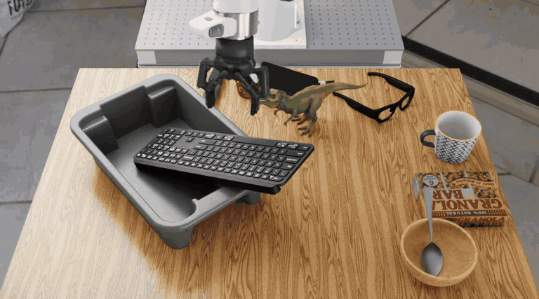
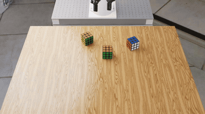
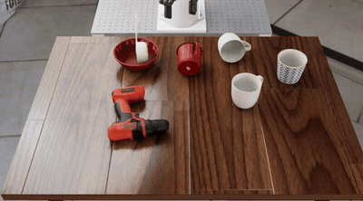

# RoboAPI × RoboLab

[English](README.md) | **简体中文**

[](https://github.com/huashanjian/roboapi-playground/actions/workflows/roboapi.yml?query=branch%3Afeat%2Froboapi-eval)
[](LICENSE)

在 [NVIDIA RoboLab](https://github.com/NVLabs/RoboLab) 中运行 [RoboAPI](https://developers.pokebot.com/docs/roboapi/latest) 策略。本分支加入了 RoboAPI 适配器、经过标定的 Franka/Robotiq 机器人组件和腕部鱼眼相机。

[任务演示](#任务演示) · [动手试试](#动手试试) · [怎样运行](#怎样运行) · [文档导航](#文档导航)

## 任务演示

### 连续收纳电子设备

> 将电子设备放进灰色收纳箱。



机器人先挪动收纳箱，再抓起鼠标并放入箱中。

<table>
  <tr>
    <th width="50%">三层魔方堆塔</th>
    <th width="50%">白杯翻正</th>
  </tr>
  <tr>
    <td></td>
    <td></td>
  </tr>
  <tr>
    <td>“把魔方堆成一座塔。”<br />预览为录像的 3 倍速。</td>
    <td>“让所有白杯直立，杯口朝上。”</td>
  </tr>
</table>

以上为仿真回放节选，录像时长不含等待 API 响应的时间。画面采用外部观察视角，策略实际接收的是腕部相机图像。

## 动手试试

需要 **Python 3.11、Isaac Sim 5.1 和 Isaac Lab 2.3.2.post1**。先按照[安装指南](docs/roboapi/setup.md#from-a-fresh-clone-to-your-first-episode)克隆当前分支，安装[标定资产包](https://github.com/huashanjian/roboapi-playground/releases/tag/roboapi-rig-v1.0.0)，配置 `.env.local` 并构建机器人。

在仓库根目录执行预检查，确认机器人、夹爪与相机可以正常运行；这一步不调用模型：

```bash
policies/roboapi/run.sh --task BananaInBowlTask --num-runs 1 \
  --preflight-only --output-folder-name roboapi_preflight
```

配置 API 密钥后，运行一个回合：

```bash
policies/roboapi/run.sh --task BananaInBowlTask --num-runs 1 \
  --output-folder-name roboapi_single
```

预检查报告位于 `output/roboapi_preflight/preflight.json`，回合产物保存在 `output/roboapi_single/`。想试上面的电子设备收纳任务，可以将 `BananaInBowlTask` 换成 `ElectronicsInBinTask`。

## 怎样运行

RoboLab 提供任务定义、回合执行流程和成功判定。适配器将这个流程接入 RoboAPI：

1. **获取观测：** 发送任务指令、单张腕部 RGB 图像、测得的工具位姿和夹爪开口宽度。模型不接收任务物体状态。
2. **执行动作：** 将返回的位姿与夹爪动作块交给仿真中的 Franka/Robotiq 机器人执行。
3. **再次观测：** 采集更新后的腕部画面和机器人状态，发起下一次请求，直到回合结束。

标定组件将策略使用的相机画面、工具坐标与夹爪响应对应到仿真机器人。[控制说明](docs/roboapi/control.md)介绍了坐标变换、工具负载补偿和夹爪动态响应。

运行器支持 RoboLab 的 **120 个任务定义**，每回合统一采用 120 秒仿真时长，最多执行 90 个动作块。机器人配置和时限与上游的差异见[评测条件](docs/roboapi/evaluation.md#evaluation-conditions)。

## 文档导航

| 要完成的工作 | 对应文档 |
| --- | --- |
| 安装仿真器、配置资产并运行第一个回合 | [安装与标定](docs/roboapi/setup.md) |
| 修改模型、API 地址或本地路径 | [配置变量](.env.example) |
| 理解坐标系、机械臂控制与夹爪响应 | [控制模型](docs/roboapi/control.md) |
| 查看观测、动作块和评测条件 | [协议与评测](docs/roboapi/evaluation.md) |
| 运行全部 120 个任务并汇总结果 | [完整评测工具](docs/roboapi/evaluation.md#complete-evaluation-tools) |

运行产物包含模型与相机设置、任务和随机种子信息、返回的动作块，以及执行日志。

<details>
<summary>常见安装问题</summary>

**需要实体机器人吗？** 不需要，这些任务在 Isaac Sim 中运行。

**标定资产包包含什么？** 工具组件、相机和执行器标定文件。Panda 几何文件、基准场景和仿真器需要另行准备，详见[所需资产](docs/roboapi/setup.md#required-assets)。

**可以更换模型吗？** 在 `.env.local` 中设置 `ROBOAPI_MODEL` 和 `ROBOAPI_BASE_URL`。API 服务须实现 [RoboAPI 模型接口协议](https://developers.pokebot.com/docs/roboapi/latest/model-contract)。

**仿真预检查失败，从哪里查起？** 先阅读 `output/roboapi_preflight/preflight.json`，再对照[安装指南](docs/roboapi/setup.md)检查资产路径和原生鱼眼相机支持。

</details>

## 测试

在独立的 Python 环境中运行离线检查：

```bash
python -m pip install -r requirements-roboapi-tests.txt
scripts/test_roboapi.sh
```

这些检查无需 Isaac Sim，也不调用模型。安装 PyTorch 后，还会在 CPU 上测试夹爪动作缓冲区。

## 致谢与许可证

本项目基于 [NVIDIA RoboLab](https://github.com/NVLabs/RoboLab)，通过 [RoboAPI](https://developers.pokebot.com/docs/roboapi/latest) 接口调用机器人策略。

代码采用 [Apache 2.0 许可证](LICENSE)，保留上游历史与 NVIDIA 版权声明。机器人、工具和基准资产各自遵循其原有许可证，详见[第三方声明](THIRD_PARTY_NOTICES.md)。

## Star History

<a href="https://www.star-history.com/?repos=huashanjian%2Froboapi-playground&amp;type=date&amp;legend=top-left">
  <picture>
    <source media="(prefers-color-scheme: dark)" srcset="https://api.star-history.com/chart?repos=huashanjian/roboapi-playground&amp;type=date&amp;theme=dark&amp;legend=top-left" />
    <source media="(prefers-color-scheme: light)" srcset="https://api.star-history.com/chart?repos=huashanjian/roboapi-playground&amp;type=date&amp;legend=top-left" />
    
  </picture>
</a>
